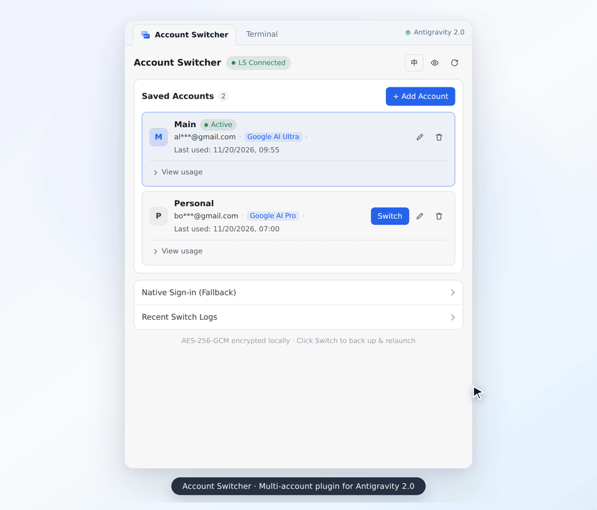

English | [简体中文](README.zh-CN.md) | [Changelog](CHANGELOG.md)

# Antigravity Account Switcher

[](https://github.com/moon16u/antigravity-account-switcher/actions/workflows/ci.yml)
[](LICENSE)


A cross-platform auxiliary-pane plugin (`SIDECAR_UI_ENTRYPOINT_AUX_PANE`) for **Google Antigravity 2.0** that manages multiple personal accounts with a **low-risk, local-first architecture**: official native Google sign-in, AES-256-GCM encrypted storage, local quota snapshots with reset-time estimation, and safe desktop restarts across Windows, WSL2, Linux, and macOS — built on **Node.js >= 18** with **zero external npm dependencies**, **zero outbound remote API calls**, and **zero idle polling**.

> [!IMPORTANT]
> **Upgrade notice (`v0.2.x / v0.3.x` → `v0.4.0`)**: `v0.4.0` switches to a local-first, low-risk architecture with no outbound Google API calls, no binary extraction, and no 60s background polling. If you installed an earlier version, please run `git pull` inside the plugin directory and restart Antigravity.
>
> **Heads-up**: I use this plugin myself every day and have not experienced any account issues or bans so far — if that ever changes, I will update this notice promptly. That said, switching multiple accounts on the same device still carries inherent platform policy risk, so please switch sensibly and be mindful with primary accounts. This is an independent MIT-licensed community tool; please assess the risk for your own setup (see [Risk Notice & Disclaimer](#risk-notice--disclaimer)).

<p align="center">
  
</p>

## Supported Platforms

| Platform | Runtime | Host & Language Server | Status |
| --- | --- | --- | --- |
| **Windows (native)** | `win32` | Windows desktop app + `language_server.exe` | Verified on real desktop + CI (`windows-latest`) |
| **WSL2 + Windows host** | `wsl` | WSL2 Linux `language_server` + Windows desktop host | Verified end-to-end on real WSL2 + Windows |
| **Linux (desktop)** | `linux` | Native Linux desktop app + `language_server` | Verified in CI (`ubuntu-latest`) |
| **macOS** | `darwin` | `Antigravity.app` (Intel & Apple Silicon) | Verified in CI (`macos-latest`); real hardware feedback welcome |

## Highlights

- **Local-First, Low-Risk Design**:
  - Makes **no outbound calls** to Google APIs, runs **no binary OAuth extraction** or custom browser OAuth callbacks, and runs **no `setInterval` background polling**.
  - All RPC traffic stays strictly on loopback (`localhost` / `127.0.0.1` / `::1`) against your local Antigravity `language_server` using the host-injected CSRF token.
- **Official Native Sign-In (`+ Add Account`)**:
  - Clicking **`+ Add Account`** syncs and backs up your current session, signs out cleanly, and restarts Antigravity into Google's official sign-in screen.
  - Once signed in, click **`Save Account`** in the panel to encrypt and add the account to your local vault.
  - On **native Windows**, panel loading spawns zero child processes; clicking **Save Account** or backing up before a switch reads `gemini:antigravity` from Windows Credential Manager on demand (preferring Python `ctypes` `CredReadW`, with non-hidden `pwsh` / `powershell.exe` fallback).
- **Local Quota Snapshots, Floating `View Usage` & One-Click `Smart Switch`**:
  - **Active account**: queries the local `language_server` (`RetrieveUserQuotaSummary`) on demand with a `30s` cache, and automatically saves a final snapshot right before switching away.
  - **Inactive accounts**: render from local snapshots (`quota-snapshots.json`) with **zero RPC or network requests**. Buckets past their `resetTime` display **`Est. reset`** / **`Est. 100%`**, and snapshots older than 24 hours show a gentle staleness hint until you switch back.
  - **Floating `View Usage` popover**: hover or click any account's **`View Usage`** bar to inspect its usage in an Antigravity-style Top-Layer floating card with zero layout shift and in-place live refresh.
  - **One-click `Smart Switch`**: ranks backup accounts locally from saved quota snapshots and reset-time projection (falling back to the least-recently-used unsnapshotted backup, zero remote requests) and previews the recommended switch in a confirmation modal.
  - Emails are masked by default with a one-click header toggle to reveal full addresses, alongside instant **`中 / EN`** language switching.
- **OS Keyring + AES-256-GCM Encrypted Vault (No Backup Bloat)**:
  - Encrypts saved accounts (`vault.enc.json`), the latest pre-switch safety backup (`last-token.enc.json`), and single-use switch jobs (`jobs/job-<uuid>.enc.json`) with a 256-bit AES-GCM master key stored in your **OS Keyring** (**Windows Credential Manager**, **macOS Keychain**, or **Linux / WSL2 Secret Service** when D-Bus is available), with verified automatic migration from legacy `vault.key` files and safe `0600` file fallback on headless / default WSL2 environments.
  - Switching accounts deduplicates and updates the active account in place inside `vault.enc.json`, overwrites the single `last-token.enc.json` file atomically, and deletes each one-time job file immediately on pickup — so repeated switching never accumulates leftover backup files.
- **Adaptive Safe Shutdown & Relaunch**:
  - Runs switches in a detached worker (`--detach-worker` double-fork on native Windows; `systemd-run --user --scope` on Linux/WSL2) so restarting Antigravity never kills the switch mid-flight.
  - Respects Antigravity's *Keep In Menu Bar* (`runInBackground`) setting on Windows/WSL2, gracefully closes visible windows first, clears Windows Credential Manager via `cmdkey.exe` with file handoff, and applies an optional random **`3–8s` natural relaunch pause** (`naturalPauseEnabled`, default on).
  - **Active-Work Guard**: checks running conversations, background tasks, terminals, and user child processes before closing the desktop app, pausing with **Recheck & Switch**, **Cancel**, or audited **Force Switch** (`FORCE_SWITCH_REQUESTED`).
- **Event-Driven Quota Alerts, MCP Tools & Hard Agent Permission Gate**:
  - **Conversation-driven monitoring**: `PostInvocation` (`hooks.json` → `scripts/quota-hook.mjs`) writes a throttled local trigger file watched by the Sidecar via `fs.watch`, updating `quota-alert.json` only during active conversations (zero idle requests). `PreInvocation` reads the local snapshot in milliseconds and injects per-conversation, per-level alerts (**`soft`** wrap-up reminder → **`hard`** switch alert) using per-session jittered thresholds (`dynamicThresholdEnabled`, default on).
  - **Bundled stdio MCP server (`0.7.0`) & `/switch-account` skill**: exposes `get_switcher_status`, `list_accounts`, `get_quota` (live local RPC for active account, local snapshot projection for inactive accounts), and `switch_account` (`pickBest: true` ranks from local snapshots with least-recently-used unsnapshotted fallback).
  - **Hard Permission Gate (`Agent Autonomous Switch`, default OFF)**:
    - When **OFF**, the Agent is strictly **read-only** (status, quota, low-quota reminders). Calling `switch_account` fails closed at the MCP server with `AGENT_SWITCH_DISABLED`, and **Auto-Resume After Switch** is automatically turned off and greyed out in the UI.
    - When **ON**, the Agent is authorized to switch on request or at the low-quota hard floor (still protected by the active-work guard), and **Auto-Resume After Switch** can be toggled independently to resume your conversation after restart once the new backend is ready.
  - **Native-Style UI & Clean Advanced Settings**: aligned with Antigravity Desktop's design language (outlined pill buttons, smooth sliding toggle switches, bundled offline **Google Sans** font, floating `View Usage` popovers, native `<dialog>` confirmations with zero layout shift, and native popover `ⓘ` tooltips with **`Low risk:`** / **`Medium risk:`** labels), dedicated `25 req/min` settings rate-limit cooldown, opt-in **Skip Repeated Onboarding Modal** (`skipOnboardingPrompt`, default OFF), and **Alert Threshold** (`10%–50%`) at the bottom.

## Scope & Known Limitations

1. **Personal Accounts Only**: Supports consumer Google accounts (`auth_method: "consumer"`); enterprise / Google Workspace SSO tokens are rejected.
2. **Desktop Restart Required**: Because Antigravity keeps the active session inside its running `language_server`, switching accounts closes the desktop app, waits for `language_server` to exit cleanly, swaps credentials, and relaunches.
3. **Inactive Usage Is a Local Estimate**: Inactive accounts display their last captured local snapshot plus reset-time projection — never remote polling. Exact figures refresh once you switch to that account.
4. **Native Sign-In Only**: Adding accounts relies on Antigravity's built-in Google sign-in flow (no self-hosted browser OAuth or binary extraction).
5. **Static Outer Tab Title**: Antigravity manifests currently accept static strings only, so the Plugins entry and side-pane tab always display **`Account Switcher`**, while all content inside the panel supports **`中 / EN`** switching.
6. **Platform Testing**: Windows (native) and WSL2 + Windows host are verified end-to-end on real desktops; Linux and macOS pass the full CI test matrix, and real-hardware macOS feedback is welcome.

## Risk Notice & Disclaimer

- **Author's Real-World Status**: I actively use this plugin on Windows and WSL2 in my own daily workflow. As of now, no account restrictions or bans have occurred from using it — should that ever change, I will document it here openly and promptly.
- **Practical Guidance**: Even with zero remote requests and zero idle polling in `v0.4.0`, rotating multiple accounts on the same device and network remains within platform policy boundaries. Consider keeping your mounted account count and daily switch frequency moderate, and leave **Agent Autonomous Switch** off for important primary accounts.
- **Disclaimer**: This is an independent open-source community project, not affiliated with or endorsed by Google, provided "AS IS" under the [MIT License](LICENSE). All credentials remain encrypted locally on your own machine. Please review and follow the relevant Google / Antigravity Terms of Service and use this tool at your own discretion; the author is not responsible for any account restrictions, quota changes, or other consequences arising from its use.

## Requirements

- **Node.js >= 18** available on the `PATH` visible to Antigravity's `language_server`.
- **Zero npm packages** — no `npm install` needed.

> **Unix `PATH` tip (WSL2 / macOS / Linux):**
>
> Antigravity's `language_server` may launch outside your interactive shell and skip `~/.bashrc`, `~/.zshrc`, or `nvm`. Make sure `node` exists in a standard system `PATH` directory (such as `/usr/local/bin/node` or `/opt/homebrew/bin/node`). On Windows, ensure `node.exe` is on your User or System `PATH` (hooks also fall back automatically to `%APPDATA%\Antigravity\bin\agy-node.cmd`).

## Installation

### Option A: Clone into the Global Plugins Folder (Recommended)

- **Unix (WSL2 / macOS / Linux)**:

  ```bash
  git clone https://github.com/moon16u/antigravity-account-switcher.git ~/.gemini/config/plugins/antigravity-account-switcher
  ```

- **Windows (PowerShell)**:

  ```powershell
  git clone https://github.com/moon16u/antigravity-account-switcher.git "$env:USERPROFILE\.gemini\config\plugins\antigravity-account-switcher"
  ```

### Option B: Clone Elsewhere & Register via `plugins.json`

1. Clone this repository to any directory (e.g., `/path/to/antigravity-plugins/antigravity-account-switcher`).
2. Register the **parent directory** with `"include_only": ["antigravity-account-switcher"]` in `~/.gemini/config/plugins.json` (Unix) or `%USERPROFILE%\.gemini\config\plugins.json` (Windows):

   ```json
   {
     "entries": [
       {
         "path": "/path/to/antigravity-plugins",
         "include_only": [
           "antigravity-account-switcher"
         ]
       }
     ]
   }
   ```

3. **Restart Antigravity** and open **`Account Switcher`** in the right auxiliary pane (or via the **Plugins** page).

## Optional Environment Variables

| Variable | Purpose |
| --- | --- |
| `ANTIGRAVITY_SWITCHER_RELAUNCH_EXE` | Custom executable (or `.vbs` launcher on Windows/WSL2) used to relaunch Antigravity after switching. |
| `ANTIGRAVITY_AGENTAPI_EXE` | Overrides `language_server` / `agentapi` discovery for local RPC, auto-resume, and macOS `.app` relaunch. |
| `ANTIGRAVITY_APP_STORAGE_PATH` | Overrides the path to `app_storage.json` (`runInBackground` detection and opt-in onboarding sync). |
| `ANTIGRAVITY_WIN_APPDATA` / `ANTIGRAVITY_WIN_LOCALAPPDATA` | Overrides Windows `%APPDATA%` / `%LOCALAPPDATA%` paths under WSL2 when auto-detection is unavailable. |
| `ANTIGRAVITY_GEMINI_DIR` / `ANTIGRAVITY_EXECUTABLE_DATA_DIR` | Overrides `~/.gemini` and the encrypted runtime data directory. |
| `SWITCHER_KEY_STORE` | Set to `file` to force local `0600` `vault.key` file storage instead of OS Keyring master-key storage. |

## Runtime Data Directory

Runtime data is isolated from plugin source files under `~/.gemini/antigravity/sidecar_data/antigravity-account-switcher/switcher/data/` (Windows: `%USERPROFILE%\.gemini\antigravity\sidecar_data\antigravity-account-switcher\switcher\data\`; standalone fallback: `~/.gemini/antigravity/plugin_data/antigravity-account-switcher/`):

- `vault.key` — Fallback 256-bit random master key (`0600` on Unix; used only when OS Keyring is unavailable, such as default WSL2 or headless Linux — automatically verified, migrated into OS Keyring, wiped, and removed on Windows / macOS / D-Bus Linux)
- `vault.enc.json` — AES-256-GCM encrypted saved accounts, deduplicated by email (`0600` on Unix)
- `last-token.enc.json` — Single-file encrypted pre-switch backup, atomically overwritten on each switch (`0600` on Unix)
- `jobs/job-<uuid>.enc.json` — Single-use encrypted switch job, deleted immediately when picked up
- `switch.log` — Sanitized audit and diagnostic log (masked emails and status codes only; never logs tokens)
- `settings.json` — Advanced Settings state (`0600` on Unix)
- `quota-snapshots.json` — Local per-account quota snapshots for reset-time projection (`0600` on Unix)
- `quota-alert.json` — Sanitized active-account quota alert snapshot and recommended backup
- `quota-refresh-trigger.json` — Throttled `PostInvocation` trigger file watched via `fs.watch`
- `hook-alert-state.json` — Per-conversation, per-level `PreInvocation` deduplication state

## Security Architecture

- **Auth Gate & Rate Limits**: Every Sidecar API requires the host-injected `ANTIGRAVITY_SIDECAR_UI_TOKEN` (`403` when missing), enforces sliding-window rate limits (`60/min` reads, `30/min` usage, `25/min` settings with `Retry-After`, `10/min` heavy writes), and guards switches with a `15s` lock.
- **Strict CSP & DOM-Safe UI**: Serves strict `Content-Security-Policy`, `X-Content-Type-Options: nosniff`, `Cache-Control: no-store`, `Referrer-Policy: no-referrer`, and `Permissions-Policy`. The frontend builds DOM nodes exclusively via `textContent` and `createElement` (zero `innerHTML`, `eval`, or inline scripts/styles).
- **OS Keyring Envelope Encryption & Local Threat Model**: Every encrypted envelope uses AES-256-GCM with a fresh 12-byte IV and 16-byte auth tag; any tampering fails decryption. On Windows, macOS, and D-Bus desktop Linux, the 256-bit master key is stored in the OS Keyring (`antigravity-account-switcher:vault-key`) rather than alongside `vault.enc.json` on disk, with secrets passed strictly over `stdin` (never CLI arguments), in-process memory caching, and mandatory read-back verification before wiping any legacy `vault.key` file. You can inspect the stored entry on Windows via **Control Panel → Credential Manager → Windows Credentials → Generic Credentials → `antigravity-account-switcher:vault-key`** (or `cmdkey /list:antigravity-account-switcher:vault-key`), and on macOS via **Keychain Access → login → `antigravity-account-switcher`**. This defends against directory exfiltration, accidental cloud sync, and cross-user reads; as with all passwordless desktop keyrings, it cannot defend against malware already running with full same-user permissions. On environments without an OS Keyring (such as default WSL2), it falls back cleanly to a `0600` `vault.key` file.
- **Prompt-Injection Hardening on Auto-Resume**: MCP `switch_account` does not accept arbitrary agent-supplied resume prompts; when **Auto-Resume After Switch** is enabled, the worker always sends a fixed, benign wakeup message to prevent indirect prompt injection from persisting across account switches.
- **Filesystem & Process Hardening**: Rejects symlinks (`lstatSync`), enforces directory containment (`assertInsideDir`), writes atomically via temp file + `renameSync`, strips prototype-pollution keys, invokes subprocesses via argument arrays only (never `shell: true`), and strips command-line arguments from active-work reports.
- **Native Windows Credential Handling**: Uses Python `ctypes` `CredReadW` on demand, falling back to plain `pwsh` / `powershell.exe -Command` without `-WindowStyle Hidden` or `-EncodedCommand`, and stops before restart if backup fails.
- **Zero External Network Surface**: No outbound Google API clients, no OAuth callback server, and no binary extraction — only loopback `language_server` RPC with host CSRF authentication.

## Repository Structure

- `plugin.json` — Plugin manifest (`antigravity-account-switcher`, `0.7.0`)
- `mcp_config.json` / `scripts/mcp-server.mjs` — Bundled zero-dependency stdio MCP server (`0.7.0`)
- `hooks.json` / `scripts/quota-hook.mjs` — Lightweight `PreInvocation` & `PostInvocation` hooks
- `skills/switch-account/SKILL.md` — `/switch-account` agent workflow skill
- `sidecars/switcher/main.mjs` — Sidecar HTTP server, `fs.watch` event-driven quota refresh, security gates & rate limits
- `sidecars/switcher/quota-snapshots.mjs` — Local quota snapshot store, active-account LS query & reset-time projection
- `sidecars/switcher/quota-guard.mjs` — Soft/hard threshold evaluation, dynamic jitter, natural pause, backup ranking & hub discovery
- `sidecars/switcher/key-store.mjs` — OS Keyring vault master-key storage (Windows Credential Manager, macOS Keychain, Linux Secret Service), stdin-only writes, verified migration & file fallback
- `sidecars/switcher/vault.mjs` — AES-256-GCM vault, atomic writes & switch job preparation
- `sidecars/switcher/token-store.mjs` — Cross-platform credential storage (macOS Keychain, Linux Secret Service, on-demand Windows Credential Manager + `cmdkey.exe`, WSL2 file store)
- `sidecars/switcher/platform.mjs` — Runtime detection, path translation, desktop relaunch & opt-in onboarding sync
- `sidecars/switcher/active-work.mjs` — Pre-switch loopback RPC & user child-process guard
- `sidecars/switcher/switcher-worker.mjs` — Detached switch, native sign-in & desktop restart worker
- `sidecars/switcher/public/` — Auxiliary-pane UI (`index.html`, `app.js`, `styles.css`, and offline `fonts/GoogleSans-Latin.woff2` under `OFL-1.1`)
- `sidecars/switcher/test/` — Isolated unit & integration test suites (`89` tests across `switcher.test.mjs` and `mcp-and-hook.test.mjs`)
- `CHANGELOG.md` / `CHANGELOG.zh-CN.md` — Bilingual release changelog

## Running Tests

```bash
node --test sidecars/switcher/test/switcher.test.mjs sidecars/switcher/test/mcp-and-hook.test.mjs
```

```bash
for f in scripts/*.mjs sidecars/switcher/*.mjs sidecars/switcher/test/*.mjs sidecars/switcher/public/app.js; do node --check "$f"; done
```

## License

[MIT](LICENSE)
