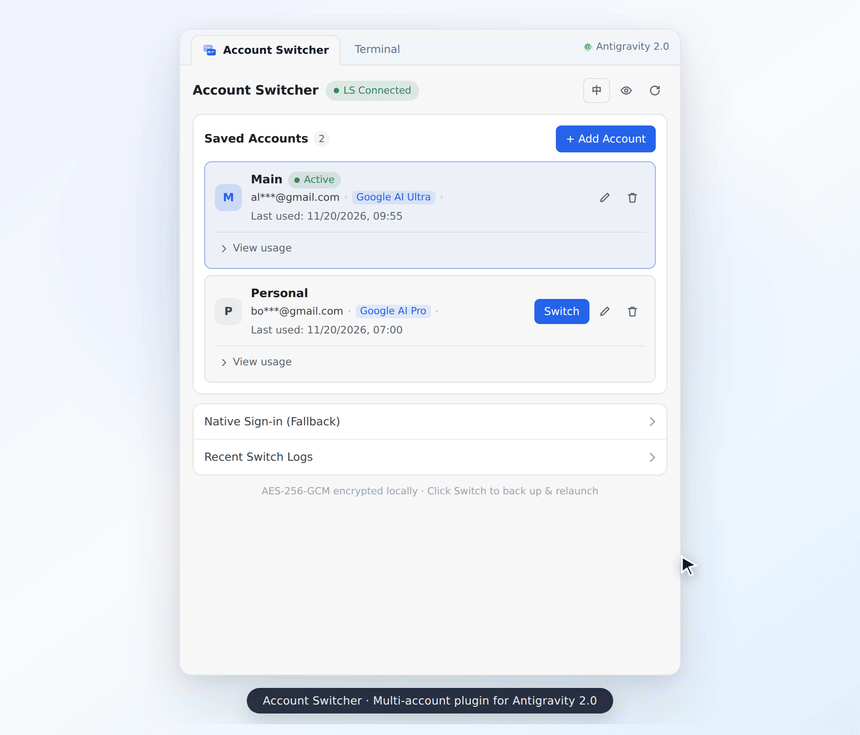

[English](README.md) | 简体中文 | [更新日志](CHANGELOG.zh-CN.md)

# Antigravity Account Switcher（Antigravity 多账号切换插件）

[](https://github.com/moon16u/antigravity-account-switcher/actions/workflows/ci.yml)
[](LICENSE)


适用于 **Google Antigravity 2.0** 的跨平台原生侧栏插件（`SIDECAR_UI_ENTRYPOINT_AUX_PANE`），采用**低风险、本地优先架构**：官方原生 Google 登录、AES-256-GCM 本地加密存储、本地配额快照与重置倒计时推算，以及面向 Windows、WSL2、Linux 与 macOS 的安全切号重启。基于 **Node.js >= 18** 开发，**零外部 npm 依赖**、**零远端 API 请求**、**零空闲后台轮询**。

> [!IMPORTANT]
> **旧版升级提醒（`v0.2.x / v0.3.x` → `v0.4.0`）**：`v0.4.0` 已切换为本地优先的低风险架构（移除远端接口直连、二进制提取与 60 秒后台轮询）。如果你此前安装过旧版本，建议尽快在插件目录执行 `git pull` 并重启 Antigravity。
>
> **使用须知**：作者本人日常也在使用本插件，截至目前尚未遇到因使用本插件导致的账号异常或封禁（如后续出现相关情况，也会第一时间同步说明）。不过同设备多账号切换本身仍存在一定的平台风控边界，建议合理控制切换频率、主力账号按需谨慎使用。本项目为独立开源工具，按 MIT 协议提供，请结合自身情况评估使用（详见[风险提示与免责声明](#风险提示与免责声明)）。

<p align="center">
  
</p>

## 支持平台

| 平台 | 运行时 | 宿主桌面端与 Language Server | 验证状态 |
| --- | --- | --- | --- |
| **Windows 原生** | `win32` | Windows 桌面端应用 + `language_server.exe` | 已真机端到端实测 + CI 验证（`windows-latest`） |
| **WSL2 + Windows 宿主** | `wsl` | WSL2 Linux `language_server` + Windows 桌面端宿主 | 已 WSL2 + Windows 双端真机实测 |
| **Linux 桌面** | `linux` | 原生 Linux 桌面端应用 + `language_server` | 已通过 CI 验证（`ubuntu-latest`） |
| **macOS** | `darwin` | `Antigravity.app`（Intel 与 Apple Silicon） | 已通过 CI 验证（`macos-latest`）；欢迎真机反馈 |

## 核心特性

- **本地优先、低风险设计**：
  - 全程**不向 Google 发起任何远端 API 调用**，**不做二进制 OAuth 提取或自建浏览器 OAuth 回调**，**不运行后台定时轮询**。
  - 唯一的网络通信是向本机回环地址（`localhost` / `127.0.0.1` / `::1`）的 Antigravity `language_server` 发起带宿主 CSRF 校验的本地 RPC。
- **官方原生登录添加账号（`+ 添加账号`）**：
  - 点击「**+ 添加账号**」会自动同步备份当前账号、安全清除当前登录态并重启桌面端应用进入官方 Google 登录页。
  - 完成登录后，回到侧栏点击「**保存当前账号**」即可加密加入切换列表。
  - 在 **Windows 原生**下，打开或刷新侧栏不启动任何子进程；仅在点击「**保存当前账号**」或切号前自动备份时，按需从 Windows 凭据管理器读取 `gemini:antigravity`（优先通过 Python `ctypes` 调用 Win32 `CredReadW`，不可用时回退至无隐藏参数的 `pwsh` / `powershell.exe`）。
- **本地配额快照、悬浮「查看用量」与一键「智能切换」**：
  - **当前活跃账号**：按需向本地 `language_server` 查询实时配额（内置 `30 秒` 缓存），并在每次切走前自动采集一次终态快照。
  - **非活跃账号**：直接读取本地快照（`quota-snapshots.json`），**零 RPC、零网络请求**；已过重置时间的配额桶按 100% 推算并标注「**预计已重置** / **预计 100%**」，超过 24 小时的快照显示温和提示，切入后自动校准。
  - **原生悬浮「查看用量」卡片**：悬停或点击每张账号卡底部的「**查看用量**」，以 Antigravity 原生风格悬浮卡片展示分组额度与圆环进度，零页面位移且支持原地刷新。
  - **一键「智能切换」**：完全基于本地配额快照与重置倒计时推算挑选最优备用号（无快照时回退至最久未用备用号，零远端请求），并在确认弹窗中预览推荐账号与预计余量。
  - 邮箱默认脱敏展示，顶部支持一键显示/隐藏完整邮箱与 **`中 / EN`** 实时切换。
- **AES-256-GCM 静态加密（无备份文件堆积）**：
  - 使用本机随机生成的 256 位主密钥（`vault.key`，Unix 下 `0600`）加密保存账号库（`vault.enc.json`）、切号前安全备份（`last-token.enc.json`）及一次性切号任务（`jobs/job-<uuid>.enc.json`）。
  - 每次切号会按邮箱原地更新 `vault.enc.json` 中的最新凭证（绝不生成重复账号条目），原子覆盖唯一的 `last-token.enc.json`，一次性任务文件被读取后立即删除，反复切号也不会堆积冗余备份文件。
- **自适应优雅重启与活跃任务护栏**：
  - 通过脱离进程树的独立执行器（Windows 原生纯 Node 双派生 `--detach-worker`；Linux/WSL2 优先 `systemd-run --user --scope`）执行切号，确保关闭桌面端应用时不会中断切换流程。
  - 自动适配 Windows/WSL2 的 *Keep In Menu Bar*（`runInBackground`）设置：先温和关闭可见主窗口，再清理托盘残留进程并等待 `language_server` 落盘退出；Windows 原生经 `cmdkey.exe` 清理旧凭据后以文件交接给桌面端重新导入；重启前支持随机 **`3–8 秒` 自然停顿**（`naturalPauseEnabled`，默认开启）。
  - **切号前活跃任务护栏**：自动检测运行中的对话、后台任务、活跃终端与用户子进程，有任务运行时暂停并给出「重新检查并切换」「取消」与记入审计日志（`FORCE_SWITCH_REQUESTED`）的「仍要强制切换」。
- **事件驱动低额度提醒、MCP 工具与「Agent 自主切号」硬权限门禁**：
  - **随对话周期触发**：`PostInvocation` Hook（`hooks.json` → `scripts/quota-hook.mjs`）写入节流触发文件，Sidecar 通过 `fs.watch` 监听并异步更新本地 `quota-alert.json`，空闲挂机严格零请求。`PreInvocation` Hook 毫秒级读取本地快照，按会话动态浮动阈值（`dynamicThresholdEnabled`，默认开启）分级去重注入提醒（**`soft`** 软性收尾提醒 → **`hard`** 硬下限提醒）。
  - **内置零依赖 stdio MCP 服务（`0.6.1`）与 `/switch-account` 技能**：提供 `get_switcher_status`、`list_accounts`、`get_quota`（活跃账号实时本地 RPC，非活跃账号本地快照推算）与 `switch_account`（`pickBest: true` 基于本地快照挑选最优备用号，无快照时回退至最久未用备用号）。
  - **「Agent 自主切号」硬权限开关（默认关闭）**：
    - **关闭时**：Agent 仅具备**只读权限**（查询状态、额度与提醒）；MCP 服务层对 `switch_account` 执行 fail-closed 硬拒绝并返回 `AGENT_SWITCH_DISABLED`，同时「**切号后自动续跑**」自动关闭并在界面中置灰禁用。
    - **开启时**：授权 Agent 在低额度硬下限或用户指令下自主切号（仍受活跃任务护栏约束），「**切号后自动续跑**」也可独立开关，在桌面端应用重启就绪后自动唤醒当前会话继续任务。
  - **宿主风格原生界面与「高级设置」面板**：对齐 Antigravity 桌面端设计语言（白底细边框药丸按钮、平滑滑动开关、离线内置 **Google Sans** 字体、原生悬浮「查看用量」卡片、零位移原生 `<dialog>` 确认窗与原生 Popover `ⓘ` 风险气泡），配备独立 `25 次/分` 设置冷却保护、可选「**跳过重复条款弹窗**」（`skipOnboardingPrompt`，默认关闭）及底部「**触发阈值**」（`10%–50%`）。

## 使用边界与已知说明

1. **仅支持个人 Google 账号**：仅支持个人消费者账号（`auth_method: "consumer"`），企业版 / Google Workspace SSO 凭据会被拒绝。
2. **切号需重启桌面端应用**：Antigravity 的登录态常驻于运行中的 `language_server` 进程内，切号必须先关闭桌面端应用、等待 `language_server` 落盘退出后替换凭据并重新启动。
3. **非活跃账号用量为本地推算**：非活跃账号展示上次活跃时采集的本地快照与重置倒计时推算，切入该账号后自动校准为实时值；插件刻意不发起任何远端配额轮询。
4. **仅通过官方原生登录添加账号**：不提供自建浏览器 OAuth 或运行时二进制提取。
5. **外层标签页标题为静态英文**：Antigravity 插件清单目前仅支持静态字符串，插件列表与侧栏标签统一显示为 **`Account Switcher`**，面板内全部文案支持一键切换 **`中 / EN`**。
6. **平台验证范围**：Windows 原生与 WSL2 + Windows 宿主已完成真机端到端验证；Linux 与 macOS 通过全部 CI 矩阵测试，欢迎 macOS 真机用户反馈。

## 风险提示与免责声明

- **作者自用状态**：作者本人日常在 Windows 与 WSL2 环境下也在使用本插件，截至目前未因此遇到账号受限或封禁；如果后续真的出现相关情况，会第一时间如实更新到这里供大家参考。
- **理性使用建议**：即便 `v0.4.0` 已彻底移除远端请求与后台轮询，同设备、同网络下轮换多个账号仍属于平台策略层面的固有风控边界。建议合理控制单机挂载的账号数量与每日切换频次，重要主力账号建议保持「Agent 自主切号」关闭、仅按需手动切换。
- **免责声明**：本项目为独立社区开源插件，与 Google 无隶属或合作关系，按 [MIT 协议](LICENSE) 以「现状（AS IS）」提供；所有账号凭证仅以加密形式保存在你的本地设备中。使用前请了解并遵守 Google / Antigravity 相关服务条款，结合自身情况自主评估；因平台策略调整或使用本插件产生的任何账号受限、配额变化或其他后果，均需由使用者自行承担。

## 运行要求

- **Node.js >= 18**（需位于 Antigravity `language_server` 可见的 `PATH` 中）。
- **零外部依赖**：无需执行 `npm install`。

> **Unix（WSL2 / macOS / Linux）`PATH` 提示：**
>
> `language_server` 通常在非交互环境下启动，可能不会加载 `~/.bashrc`、`~/.zshrc` 或 `nvm`。请将 `node` 安装或软链至系统标准 `PATH`（如 `/usr/local/bin/node` 或 `/opt/homebrew/bin/node`）。Windows 下请确保 `node.exe` 位于用户或系统 `PATH`（Hook 在缺失时会自动回退至 `%APPDATA%\Antigravity\bin\agy-node.cmd`）。

## 安装与启用

### 方式一：直接克隆至全局插件目录（推荐）

- **Unix（WSL2 / macOS / Linux）**：

  ```bash
  git clone https://github.com/moon16u/antigravity-account-switcher.git ~/.gemini/config/plugins/antigravity-account-switcher
  ```

- **Windows（PowerShell）**：

  ```powershell
  git clone https://github.com/moon16u/antigravity-account-switcher.git "$env:USERPROFILE\.gemini\config\plugins\antigravity-account-switcher"
  ```

### 方式二：克隆至自定义目录并通过 `plugins.json` 注册

1. 将仓库克隆至任意目录（例如 `/path/to/antigravity-plugins/antigravity-account-switcher`）。
2. 在 `~/.gemini/config/plugins.json`（Unix）或 `%USERPROFILE%\.gemini\config\plugins.json`（Windows）中注册其**上级目录**，并指定 `"include_only": ["antigravity-account-switcher"]`：

   ```json
   {
     "entries": [
       {
         "path": "/path/to/antigravity-plugins",
         "include_only": [
           "antigravity-account-switcher"
         ]
       }
     ]
   }
   ```

3. **重启 Antigravity**，在右侧辅助栏打开「**Account Switcher**」标签页（或在 **Plugins** 页面启用）即可使用。

## 可选环境变量

| 环境变量 | 说明 |
| --- | --- |
| `ANTIGRAVITY_SWITCHER_RELAUNCH_EXE` | 自定义切号后重启桌面端应用的可执行文件路径（Windows/WSL2 下同时支持 `.vbs` 启动脚本）。 |
| `ANTIGRAVITY_AGENTAPI_EXE` | 覆盖本地 RPC、自动续跑及 macOS `.app` 定位使用的 `language_server` / `agentapi` 路径。 |
| `ANTIGRAVITY_APP_STORAGE_PATH` | 覆盖 `app_storage.json` 路径（用于读取 `runInBackground` 及可选引导记录同步）。 |
| `ANTIGRAVITY_WIN_APPDATA` / `ANTIGRAVITY_WIN_LOCALAPPDATA` | 在非标准 WSL2 环境下覆盖 Windows `%APPDATA%` / `%LOCALAPPDATA%` 路径解析。 |
| `ANTIGRAVITY_GEMINI_DIR` / `ANTIGRAVITY_EXECUTABLE_DATA_DIR` | 覆盖 `~/.gemini` 与 Sidecar 运行时加密数据目录。 |

## 运行时数据目录

运行时数据与插件源码完全隔离，默认位于 `~/.gemini/antigravity/sidecar_data/antigravity-account-switcher/switcher/data/`（Windows 为 `%USERPROFILE%\.gemini\antigravity\sidecar_data\antigravity-account-switcher\switcher\data\`；独立运行回退至 `~/.gemini/antigravity/plugin_data/antigravity-account-switcher/`）：

- `vault.key` — 本机随机 256 位 AES 主密钥（Unix 下 `0600`）
- `vault.enc.json` — AES-256-GCM 加密账号库，按邮箱原地更新去重（Unix 下 `0600`）
- `last-token.enc.json` — 切号前活跃凭证单文件紧急备份，每次原子覆盖不堆积（Unix 下 `0600`）
- `jobs/job-<uuid>.enc.json` — 一次性加密切号任务，执行器读取后立即删除
- `switch.log` — 脱敏审计与诊断日志（仅记脱敏邮箱与状态码，永不记录令牌）
- `settings.json` — 高级设置配置（Unix 下 `0600`）
- `quota-snapshots.json` — 本地分账号配额快照，用于非活跃账号重置推算（Unix 下 `0600`）
- `quota-alert.json` — 脱敏的活跃账号低额度预警快照与推荐备用号
- `quota-refresh-trigger.json` — 由 `PostInvocation` 写入、`fs.watch` 监听的节流触发文件
- `hook-alert-state.json` — `PreInvocation` 按会话与级别去重的状态记录

## 安全架构

- **鉴权与分级限流**：所有接口强制校验宿主注入的 `ANTIGRAVITY_SIDECAR_UI_TOKEN`（缺失时 `403` 拒绝），启用滑动窗口限流（读 `60 次/分`、用量 `30 次/分`、高级设置 `25 次/分` 并返回 `Retry-After`、重型写操作 `10 次/分`）与 `15 秒` 切号互斥锁。
- **严格 CSP 与无注入前端**：附带严格 `Content-Security-Policy`、`X-Content-Type-Options: nosniff`、`Cache-Control: no-store`、`Referrer-Policy: no-referrer` 与 `Permissions-Policy` 响应头；前端全部使用 `textContent` 与标准 DOM API 构建，零 `innerHTML`、零 `eval`、零内联脚本与样式。
- **加密完整性校验与本地威胁边界**：每条密文使用 AES-256-GCM 配合唯一 12 字节随机 IV 与 16 字节认证标签，任何篡改直接拒绝解密。为避免每次切号弹出主密码输入框，`vault.key` 与 `vault.enc.json` 同目录以 `0600` 权限保存在本地——这可防范跨用户读取与误提交泄露，但无法抵御已在本机获得同用户完整执行权限的恶意软件。
- **自动续跑防提示词注入加固**：MCP `switch_account` 不接受 Agent 传入任意自定义续跑文本；开启「切号后自动续跑」时始终使用内置固定良性唤醒语，防止间接 Prompt 注入借切号重启在新账号会话中持久化执行指令。
- **文件系统与进程加固**：拒绝敏感路径符号链接（`lstatSync`）、校验目录边界（`assertInsideDir`）、临时文件 + `renameSync` 原子写入、过滤原型链污染键；子进程调用一律使用参数数组（禁用 `shell: true`），活跃子进程提示仅显示可执行文件名与 PID，不泄露命令行参数。
- **Windows 原生凭据读取**：按需通过 Python `ctypes` 调用 `CredReadW`，不可用时依次回退至普通 `pwsh` / `powershell.exe -Command`（绝不使用 `-WindowStyle Hidden` 或 `-EncodedCommand`）；若备份读取失败会在重启前中止操作。
- **零外部网络攻击面**：不含任何远端 Google API 客户端、OAuth 回调服务或二进制提取逻辑，仅允许带宿主 CSRF 校验的本机回环 RPC。

## 仓库结构

- `plugin.json` — 插件清单（`antigravity-account-switcher`，`0.6.1`）
- `mcp_config.json` / `scripts/mcp-server.mjs` — 内置零依赖 stdio MCP 服务（`0.6.1`）
- `hooks.json` / `scripts/quota-hook.mjs` — 轻量事件驱动 `PreInvocation` / `PostInvocation` Hook
- `skills/switch-account/SKILL.md` — 面向 Agent 的 `/switch-account` 技能工作流
- `sidecars/switcher/main.mjs` — Sidecar HTTP 服务、`fs.watch` 触发刷新、安全门禁与限流
- `sidecars/switcher/quota-snapshots.mjs` — 本地配额快照存储、活跃账号本地查询与重置推算
- `sidecars/switcher/quota-guard.mjs` — 软/硬阈值判定、动态抖动、自然停顿、备用号排序与活跃 Hub 探测
- `sidecars/switcher/vault.mjs` — AES-256-GCM 凭据库、原子写入与切号任务构造
- `sidecars/switcher/token-store.mjs` — 跨平台凭据读写层（macOS Keychain、Linux Secret Service、Windows 按需读取与 `cmdkey.exe` 交接、WSL2 文件存储）
- `sidecars/switcher/platform.mjs` — 运行时检测、路径转换、桌面端重启与可选引导同步
- `sidecars/switcher/active-work.mjs` — 切号前回环 RPC 与用户子进程检测护栏
- `sidecars/switcher/switcher-worker.mjs` — 脱离进程树的独立切号、原生登录与桌面端重启执行器
- `sidecars/switcher/public/` — 侧栏 Web UI（`index.html`、`app.js`、`styles.css` 及离线 `fonts/GoogleSans-Latin.woff2`，`OFL-1.1`）
- `sidecars/switcher/test/` — 全隔离单元与集成测试套件（共 `63` 项，覆盖 `switcher.test.mjs` 与 `mcp-and-hook.test.mjs`）
- `CHANGELOG.md` / `CHANGELOG.zh-CN.md` — 中英文双语更新日志

## 运行测试

```bash
node --test sidecars/switcher/test/switcher.test.mjs sidecars/switcher/test/mcp-and-hook.test.mjs
```

```bash
for f in scripts/*.mjs sidecars/switcher/*.mjs sidecars/switcher/test/*.mjs sidecars/switcher/public/app.js; do node --check "$f"; done
```

## 开源许可

[MIT](LICENSE)
